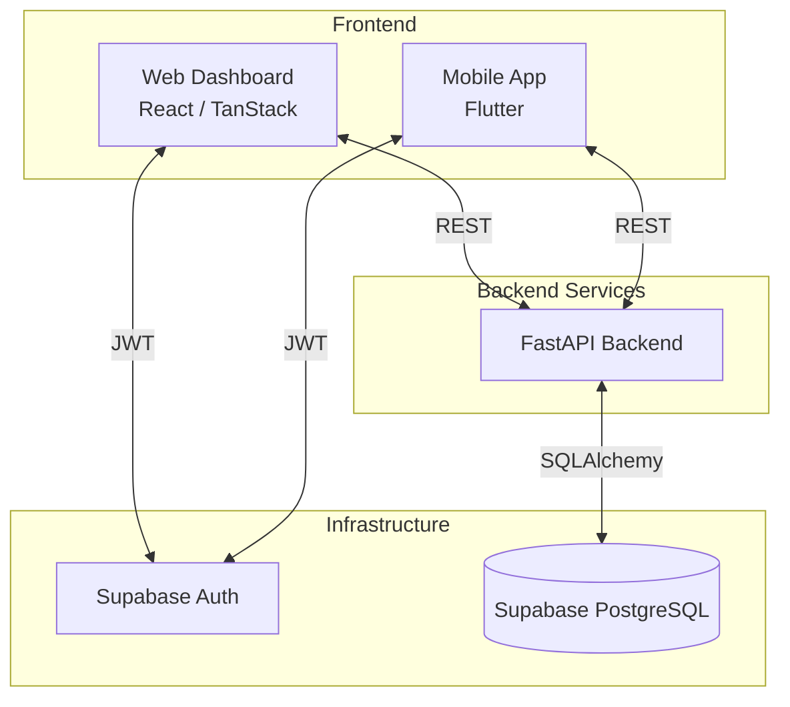
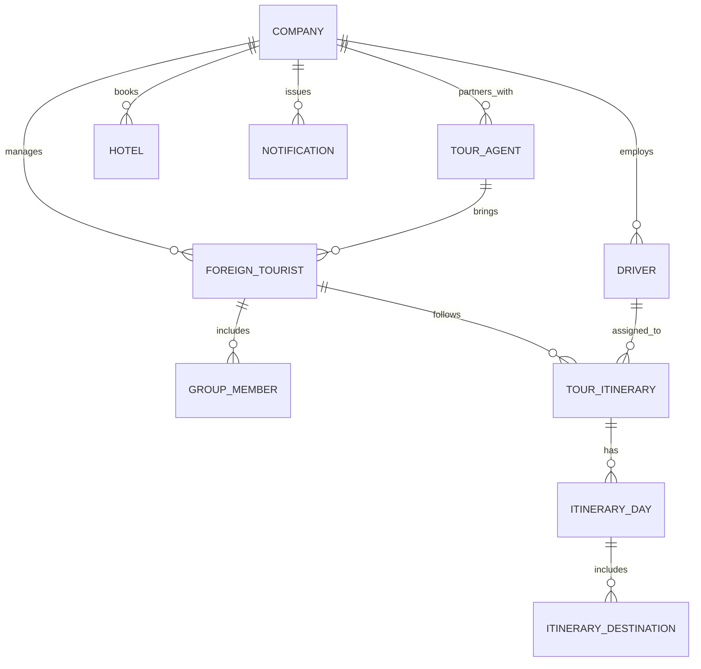

# CST Tour Management System


## 📌 Project Overview
The **CST (Ceylon Signature Travels) Tour Management System** is a comprehensive, centralized platform designed to streamline operations for tour management companies. It handles everything from registering tourists, organizing day-by-day itineraries, managing hotel bookings, to assigning drivers and tour agents.

The project is structured iteratively:
- **Version 1.0 (MVP):** Core back-office operations (Web Dashboard & Backend API).
- **Version 2.0:** Mobile Application extension for drivers/guides to view itineraries and sync offline.

---

## 🏗️ System Architecture

The platform follows a modern separated-presentation architecture, with a web frontend, a mobile application, and a robust RESTful API backed by a cloud-native database.



---

## 🛠️ Technology Stack

### Frontend (Web Dashboard)
- **Framework:** React 19, Vite
- **Routing/SSR:** TanStack Start / React Router
- **Styling:** Tailwind CSS v4
- **UI Components:** Radix UI (shadcn/ui style components), Lucide Icons
- **State Management:** TanStack Query (React Query)
- **Language:** TypeScript

### Backend (API)
- **Framework:** FastAPI (Python 3.10+)
- **Server:** Uvicorn
- **ORM:** SQLAlchemy with Alembic (Migrations)
- **Database Driver:** `psycopg2-binary`
- **Other Utilities:** Resend (Emails), Google GenAI, PyMuPDF (PDF Generation)
- **Language:** Python

### Mobile Application (Driver App)
- **Framework:** Flutter (>=3.2.0)
- **State Management:** Riverpod
- **Offline Storage:** sqflite (SQLite)
- **Backend SDK:** `supabase_flutter`
- **Language:** Dart

### Database & Authentication
- **Database Engine:** PostgreSQL
- **Provider:** Supabase
- **Authentication:** Supabase Auth

---

## 🗄️ Database Schema (ERD)



---

## 🚀 Deployment Strategy

### 1. Database (Supabase)
- Hosted on Supabase Cloud.
- Automatic daily backups and Point-in-Time Recovery (PITR).
- Environment separated into `Development`, `Staging`, and `Production` Supabase projects.

### 2. Backend (FastAPI)
- **Platform:** Render, Railway, or AWS Elastic Beanstalk.
- **CI/CD:** GitHub Actions to automatically build and deploy Docker containers on merge to `main`.
- **Environment Variables:** Handled via platform secrets (Supabase credentials, Resend API key, GenAI keys).

### 3. Frontend (React/Vite)
- **Platform:** Vercel or Netlify.
- **CI/CD:** Vercel's automated git integrations.
- **Build Command:** `npm run build`

### 4. Mobile App (Flutter)
- **Android:** Google Play Console (Internal Testing -> Production).
- **iOS:** Apple App Store Connect (TestFlight -> App Store).
- **CI/CD:** Codemagic or GitHub Actions for automated IPA/AAB builds.

---

## 💻 Local Development Setup

### Prerequisites
- Node.js (v18+)
- Python (3.10+)
- Flutter SDK (3.2.0+)
- Git

### 1. Backend Setup
```bash
cd backend
python -m venv venv
# Windows: venv\Scripts\activate | Mac/Linux: source venv/bin/activate
pip install -r requirements.txt
cp .env.example .env # Update Supabase & DB credentials
uvicorn main:app --reload
```

### 2. Frontend Setup
```bash
cd frontend
npm install
npm run dev
```

### 3. Mobile App Setup
```bash
cd CST-App
flutter pub get
flutter run
```

---

## 🔑 Key Features
* **Role-Based Access Control (RBAC):** Distinct views for Company Admins, Tour Agents, and Drivers.
* **Itinerary Builder:** Day-by-day tour planning with dynamic destination allocation and hotel syncing.
* **Offline-First Mobile App:** Drivers can view their assigned itineraries even without an internet connection using local SQLite caching.
* **Real-time Notifications:** Alerts for last-minute itinerary changes or driver reassignment.
* **Automated PDF Generation:** Generating customized trip summaries and invoices.
